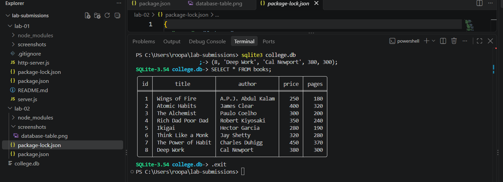
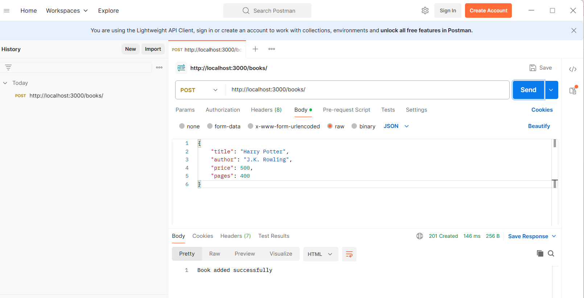
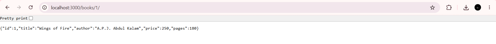
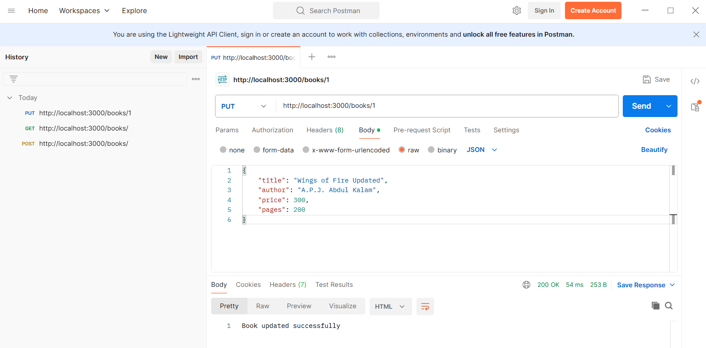

# Lab 2: SQLite Database and CRUD Routes

**Name:** Mandava Roopa Santhoshi 
**Registration Number:** 252U1R6111 
**Section:** AIML-2B-207

## Live Deployment

**Live URL:** `https://your-render-service.onrender.com`

*Replace this placeholder with your actual Render URL after deployment.*

## Objective

To connect an Express.js server with an SQLite database and implement CRUD operations through REST API endpoints.

## Technologies Used

- Node.js
- Express.js
- SQLite
- JavaScript
- Postman

## Project Structure

```text
lab-02/
├── screenshots/
│   ├── database-table.png
│   ├── post-book.png
│   ├── get-all-books.png
│   ├── get-single-book.png
│   ├── put-book.png
│   ├── delete-book.png
│   └── error-book.png
├── database.js
├── server.js
├── books.db
├── package.json
├── package-lock.json
├── .gitignore
└── README.md
```

## Installation and Execution

1. Clone the repository:

   ```bash
   git clone <your-github-repository-url>
   ```

2. Navigate to the project folder:

   ```bash
   cd lab-02
   ```

3. Install dependencies:

   ```bash
   npm install
   ```

4. Start the development server:

   ```bash
   npm run dev
   ```

5. Open the API at:

   `http://localhost:3000`

**Environment Variables:** No environment variables are required for the current local setup.

## API Endpoints

| Method | Endpoint | Description |
|---|---|---|
| GET | `/books/` | Retrieve all books |
| GET | `/books/:bookId/` | Retrieve a book by ID |
| POST | `/books/` | Add a new book |
| PUT | `/books/:bookId/` | Update an existing book |
| DELETE | `/books/:bookId/` | Delete a book |

## Screenshots

### 1. SQLite Database Table


### 2. Add a Book - POST


### 3. Retrieve All Books - GET


### 4. Retrieve a Single Book - GET


### 5. Update a Book - PUT


### 6. Delete a Book - DELETE


### 7. Error Handling


## Deployment

The application will be deployed using Render.

- **Build Command:** `npm install`
- **Start Command:** `npm start`

A persistent disk or another persistent database storage solution is required to retain SQLite data across deployments and restarts.

